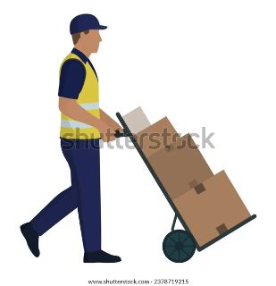
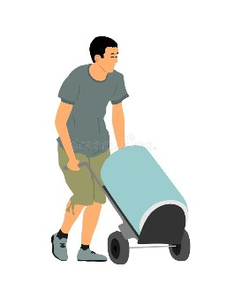
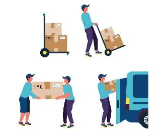
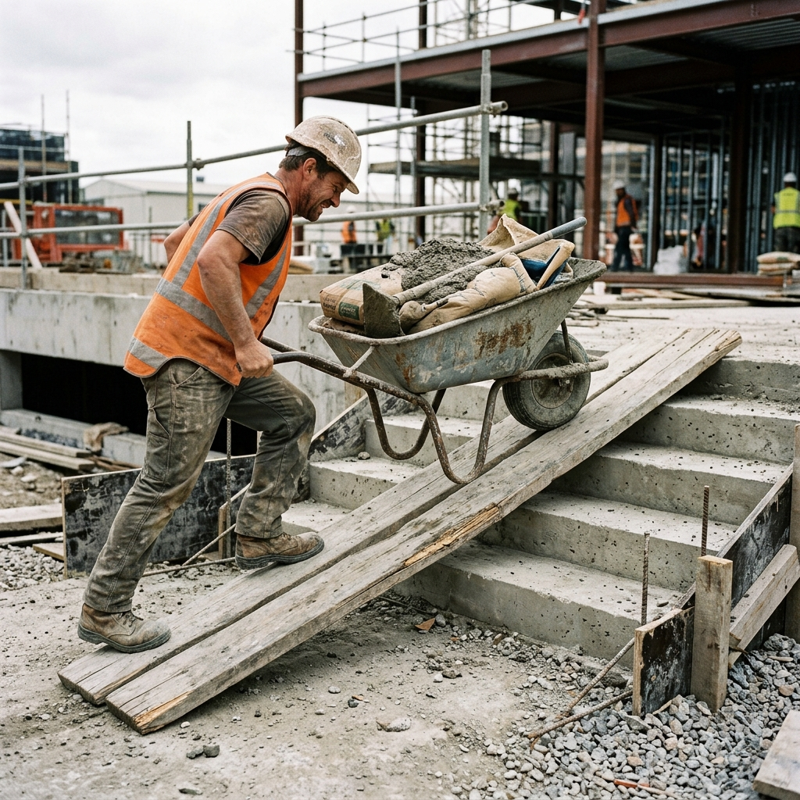
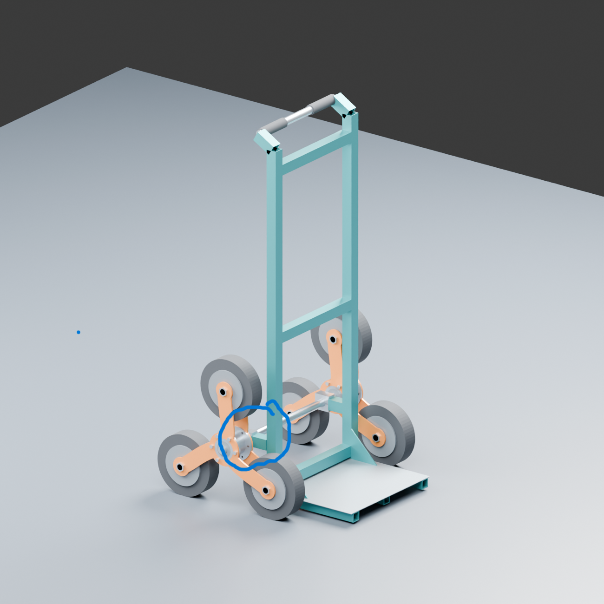

# The Problem

Moving a load across a flat floor is one thing; getting it up a staircase is another. With a regular trolley, the person handling it may have to lift or pull the wheels over each step while keeping the load balanced. Over a full flight of stairs, this becomes a repeated effort.

This project focuses on making that task easier to control, with less repeated lifting and less manual pulling effort.

## What makes it difficult?

### Getting over each step

The edge of a step interrupts the rolling motion of an ordinary trolley. The operator has to help the wheels and load get past it. The effort changes as the trolley moves between steps, so a movement that starts smoothly can become a sudden pull or jerk.

### Keeping the load stable

The trolley tilts as it climbs. Where the load sits affects its balance and how much effort is needed at the handle. A load that shifts or sits too high can make the trolley harder to control.

### Moving through a whole staircase

Getting over one step is only part of the problem. The trolley needs to make repeated transitions without catching the frame, losing balance, or forcing the operator to reposition the load. Narrow stairs and small landings also limit the room available.

### Supporting the load without excessive flexing

The chassis, wheel supports, shafts, and joints need to hold their alignment as the load moves between contact points. Bending, looseness, or damage could affect how the mechanism works.

### Controlling the way down

Descending also needs attention. The operator must be able to lower the load between steps without letting the trolley run ahead or tip.

## How people move loads now

### A regular hand truck

A hand truck supports a tilted load, but its wheels still have to get past each stair edge.

*Reference illustration of a regular hand truck.*

### A wheelbarrow or cart

These can help move materials, but stairs may still require a ramp or lifting assistance.

*Reference illustration of a wheelbarrow.*

### Carrying by hand

People may carry items individually or work together to lift them. This requires them to support the load and coordinate their movements.

*Reference illustrations of manual handling.*

### A plank used as a ramp

A plank laid over stairs provides another route for the wheels. Its support, grip, slope, and the space available all affect how manageable that route is.

*Illustration of the ramp arrangement. The image source and site details have not been recorded.*

## Who this could help

Possible users include people moving deliveries, shop goods, household items, or construction materials between levels where a lift is unavailable. I still need to choose the main use case so the design addresses a specific task.

## What I need to observe

I will record what people carry, how they move it now, where they struggle, and when they need another person's help. Photos and notes should include the situation and date so they can support the problem statement.

The intended improvement is a trolley that carries the load through repeated stair transitions with less effort and better control. Its performance will need to be checked through actual tests.

## What the earlier prototype taught us

### Frame hitting the stairs before the wheels — observation from another group

During our first-year project, another group worked on a similar stair-climbing trolley. As recalled by Shashank on 10 October 2026, their trolley had a clearance problem: the body/frame could touch the stairs before the leading wheel reached the step. This prevented the wheel cluster from engaging the stair as intended.

Our first Blender layout raises the same concern. The marked area below identifies the connection and offset between the main axle/wheel cluster and the upright frame. Its length and position need to be chosen so that the leading tyre meets the stair before the frame, bracket or loading platform does. The relevant direction is the direction of travel towards the stair; “rightmost” in a perspective picture is not a fixed design direction.

*User annotation of our Blender preview, supplied on 10 October 2026. This is not a photograph of the other group's trolley or a measured collision test.*

The lesson is to check which part reaches the step first, rather than only checking wheel size. We still need to establish the required offset through a side-view contact study at different trolley tilts and carrier positions. The other group's dimensions and test conditions have not been recorded, and this failure has not yet been reproduced in our model. See the [modelling plan](../04-cad/modelling-plan.md) for the next check.

### Findings recorded in our original report

The original project report records slight tilting with heavier loads, a need for better traction on wet or slippery surfaces, and higher costs when using higher-quality materials. These give the rebuild three concrete issues to investigate: load balance, grip, and cost.

The report does not give the load at which tilting began or detailed surface conditions. Recording those details during new trials will help turn these observations into design decisions. See the [earlier project record](../07-documentation/project-background.md).
