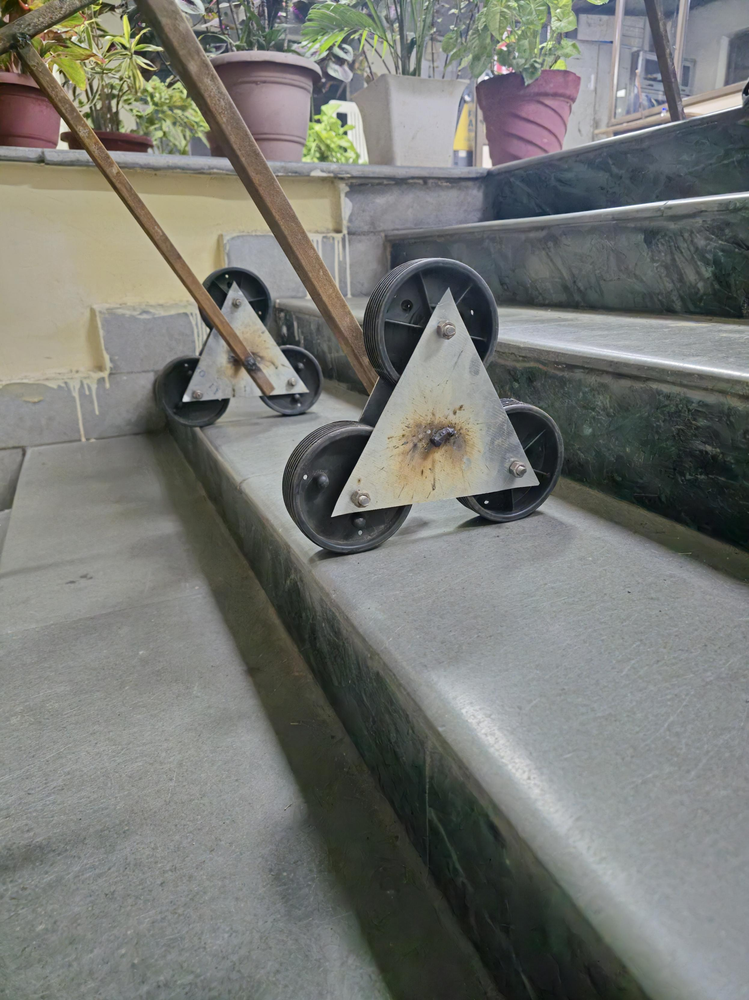

# Mechanical Work

This folder connects the design to the physical build: the dimensions, loads, calculations, components, fabrication, and assembly.

Start with the [design requirements](design-requirements.md), [preliminary calculations](calculations.md) and [bill of materials](bill-of-materials.md). The 50 kg payload is a design target; measured stairs and supplier-confirmed parts are still needed. No fabrication of the current rebuild is recorded.

## Mechanism and geometry

Develop the tri-star wheel arrangement around the intended stairs. Record the wheel radius, carrier radius, axle spacing, track width, and frame clearance. Sketch the contact points at the beginning, middle, and end of a transition, then check the pattern over consecutive steps.

## Torque and manual pull force

Create a free-body diagram for each important climbing position. Record the trolley and payload weights, their centres of gravity, the handle force direction, support contacts, and relevant moment arms.

Identify the positions with the highest expected torque and pull force. Include rolling resistance, friction, and dynamic effects where the chosen model supports them, and state any simplifications. Keep carrier torque, wheel torque, and force at the handle clearly distinguished.

| Position or load case | Inputs and assumptions | Method or calculation file | Torque | Handle force |
| --- | --- | --- | --- | --- |
| | | | | |

Record units with every result. Compare the predicted handle force with measurements during testing.

## Load distribution and centre of gravity

Work out the combined centre of gravity of the frame, mechanism, and payload for the planned load positions. Study how the balance changes with trolley tilt and with different wheels touching the stairs.

Check both sideways and fore-aft tipping tendencies, including the effect of the operator's force. Use the findings to adjust the platform, track width, handle, and payload placement. A static check is only part of the assessment; stair trials must also examine motion and load shifts.

## Structural checks

Check the frame, wheel carriers, axles, bearings, fasteners, and joints for the selected loads. Include bending, shear, deflection, and connection loads where relevant. State the basis for any dynamic allowance or factor of safety rather than assuming a value.

| Component | Load case | Material and dimensions | Check or calculation | Outcome |
| --- | --- | --- | --- | --- |
| | | | | |

## Bill of materials

The [preliminary BOM](bill-of-materials.md) records selected sizes, quantities and unfinished details. Supplier quotes, final cut lengths, actual mass and cost are pending.

## Fabrication and assembly

1. Complete the drawings and check the selected parts against them.
2. Make the frame and carriers, recording actual dimensions.
3. Fit the axles, bearings, wheels, and retention hardware.
4. Assemble the handle, platform, and load restraints.
5. Check alignment, free movement, clearances, and joint condition.
6. Record the finished mass and prepare the prototype for the test plan.

| Date | Part or operation | Process and tools | Check or measurement | Photo or note |
| --- | --- | --- | --- | --- |
| | | | | |

These are the planned work areas. Add actual calculations and build records as they are completed.

## Earlier fabrication work

The first-year report records cutting and welding the frame, assembling the tri-wheel mechanism with shafts and bearings, and adjusting the wheel spacing and handle design. The supplied photographs show a fabricated rectangular frame and two triangular three-wheel assemblies.

The exact material grades, member sizes, wheel diameters, bearing details, joint specifications, and cost breakdown are not listed in the report. Record these from recovered information or new measurements before using the old build as a dimensional reference.

The report describes a platform intended to carry up to 50 kg and mentions load testing in the 30–50 kg range. It does not include a test log establishing a rated capacity. Keep those figures as context for the earlier build while selecting and checking the new payload target.
