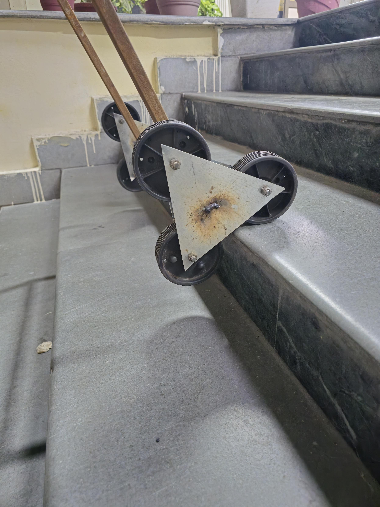
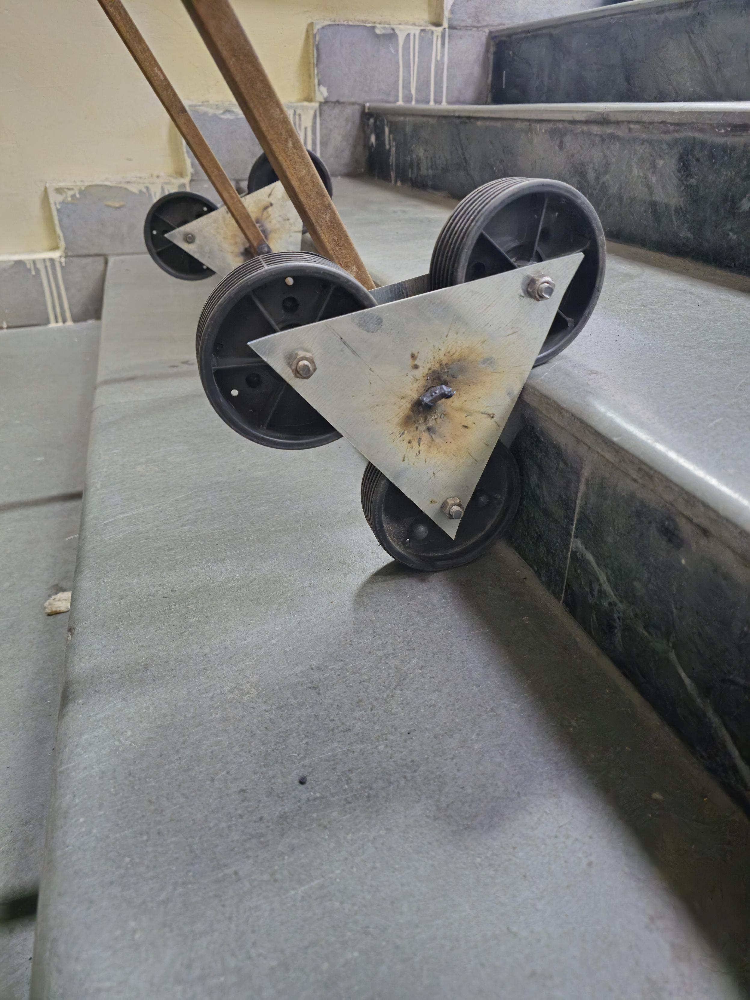

# Project Documentation

This folder will tell the story of the trolley from the first sketches to the finished prototype, with enough detail to show why the design choices were made and what the tests actually found.

[Project background](project-background.md) · [Progress log](PROGRESS.md)

[Remaining work and information needed](remaining-work.md) · [Earlier project-study notes](project-study.md)

## What the final report should cover

1. The problem, intended users, and operating conditions.
2. The tri-star concept and the research behind the mechanism.
3. Stair measurements, payload target, and design requirements.
4. Mechanism geometry and the CAD model of the chassis and assembly.
5. Torque and manual pull-force calculations.
6. Load distribution, centre-of-gravity placement, and rollover assessment.
7. Component selection, structural checks, materials, and cost.
8. Fabrication and assembly, including changes made during the build.
9. Static and dynamic payload tests, stair traversal, and the pull-force comparison.
10. Measured results, limitations, and future improvements.

## Evidence to collect

| Project objective | Supporting material |
| --- | --- |
| Tri-star stair traversal | Mechanism sketches, dimensions, CAD checks, and video on measured stairs. |
| Chassis design | Editable CAD, assembly views, manufacturing drawings, and finished measurements. |
| Torque analysis | Free-body diagrams, inputs, assumptions, calculations, and comparison with test forces. |
| Load distribution and stability | Mass properties, payload positions, stability checks, and observations during full-flight trials. |
| Fabrication | Bill of materials, process notes, assembly photos, and dimensional checks. |
| Structural rigidity | Calculations, measured deflection, and post-test inspections. |
| Reduced pull force | Baseline setup, raw force measurements, repeated trials, and a comparison chart or table. |

## Photos and files

Give photos a date and a short caption explaining what they show. Link calculations and test data from the report so the results can be traced back to the work.

Update the current documents directly as information is added. Preserve the complete current design if a substantially different concept is developed later.

[Initial workspace notes](initial-workspace-notes.md) are retained only as an old setup record, not as a separate design.

## Original project report

[Open the MCP101 report](original-prototype/report/mcp101-project-report.docx). The original file is retained unchanged. It describes the group project, build approach, reported results, limitations, and future ideas.

## Original prototype photographs

These four photographs were extracted unchanged from the report. They show the earlier build; their individual capture dates are not recorded here.

*Overall view of the fabricated frame and wheel assemblies.*

*Both three-wheel clusters visible on the staircase.*

*Close view of the carrier and wheels at a step edge.*

*Another photographed orientation of the wheel cluster. The still photographs alone do not establish the direction or timing of movement.*
