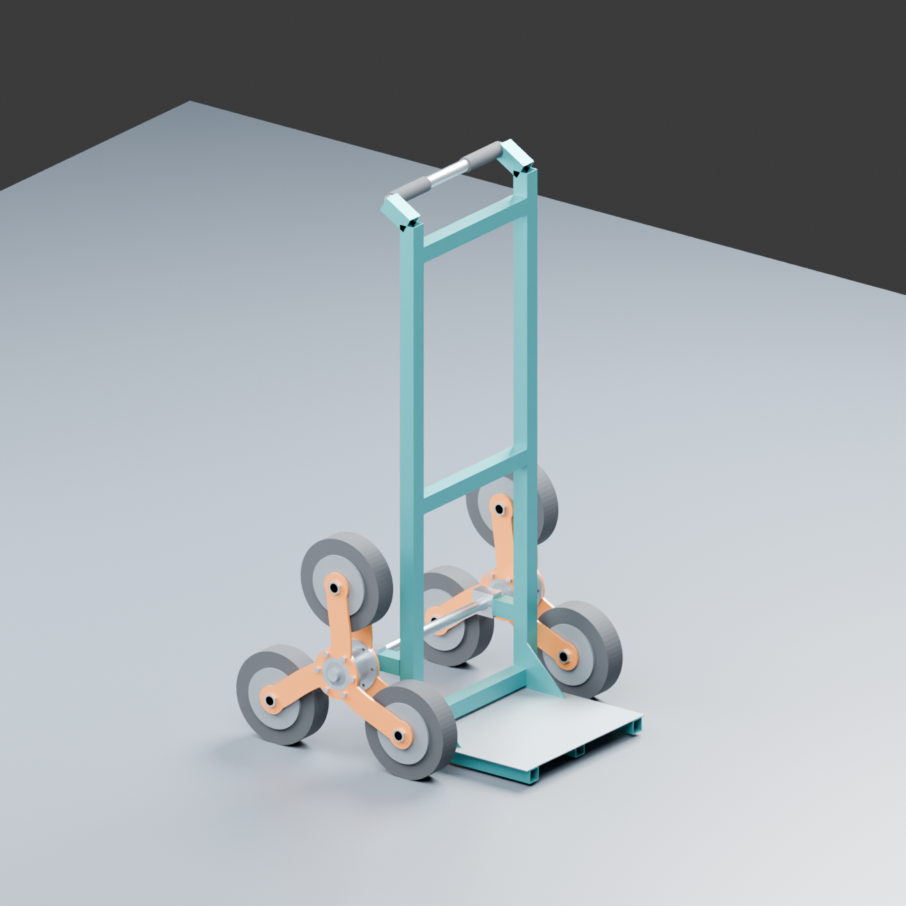
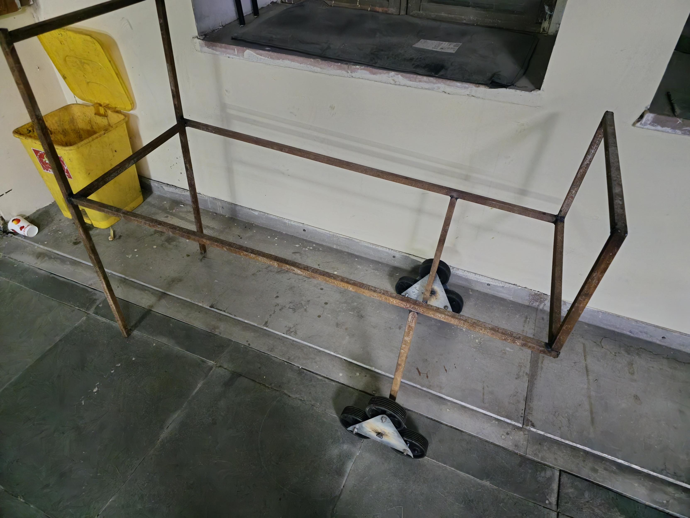

# Staircase Climbing Trolley

A project to design, build, and test a trolley that can carry loads up and down stairs using a three-wheel tri-star cluster mechanism.

I first worked on this project in October 2024 with Prof. Sagar Sarkar. I am now working through it again from the beginning and documenting each stage, from understanding the problem to testing the finished prototype.

## Current progress — 11 October 2026

The original prototype report and photographs are preserved. The rebuild now has a ten-paper literature review, preliminary engineering calculations and an editable Blender assembly. The current scope is **fully mechanical, with no electric drive or electronic levelling**.

*Preliminary geometry, not a tested or fabrication-ready trolley. The longer axle-to-frame connection and assisted-tilt ideas remain discussion items; they have not been implemented.*

| Area | Status |
| --- | --- |
| Problem and earlier experience | Documented; includes the reported frame-before-wheel contact issue |
| Research | Ten published studies reviewed, with a calculation audit and Indian stair references |
| Engineering | Preliminary sizing and material choices; actual stair and component measurements pending |
| Blender | First assembly, source scripts and geometry checks available; see the checks for their exact scope |
| New fabrication and physical testing | Not started/documented for this rebuild; no verified load rating or pull-force improvement |

The **50 kg payload is a target**, not a demonstrated capacity. See [remaining work and information needed](07-documentation/remaining-work.md).

## Start here

- [Research and design basis](03-research/trolley-research-and-cad-design-basis.md)
- [Editable Blender assembly](04-cad/blender/stair-trolley.blend) · [How to use it](04-cad/blender/README.md)
- [Modelling plan](04-cad/modelling-plan.md)
- [Engineering calculations](05-mechanical-work/calculations.md) · [Preliminary bill of materials](05-mechanical-work/bill-of-materials.md)
- [Original MCP101 report](07-documentation/original-prototype/report/mcp101-project-report.docx)

## What I want to achieve

- Design a tri-star wheel arrangement that can move over the stair profiles selected for this project with controlled, smooth transitions.
- Model the chassis, wheel clusters, shafts, handle, and load platform in CAD.
- Work out the torque and manual pull force needed during stair climbing.
- Improve load distribution and centre-of-gravity placement to reduce the risk of rollover during a full flight of stairs.
- Fabricate and assemble a working prototype.
- Test it with secured payloads while stationary and while moving on stairs.
- Check structural rigidity and measure whether it needs less manual pulling force than a regular trolley under comparable conditions.

These are the goals for the current work. Dimensions, calculations, and measured results will be added as the project develops.

## Where each part of the work goes

| Folder | What it covers |
| --- | --- |
| [Problems](01-problems) | Why moving loads on stairs is difficult and what needs to improve. |
| [How the idea came](02-how-the-idea-came) | Project background, the tri-star concept, and the reasoning behind it. |
| [Research](03-research) | Mechanism geometry, existing designs, stair interaction, materials, and supporting sources. |
| [CAD](04-cad) | Parts, assemblies, motion checks, mass properties, and manufacturing drawings. |
| [Mechanical work](05-mechanical-work) | Requirements, calculations, component selection, fabrication, and assembly. |
| [Testing](06-testing) | Stair trials, payload tests, rigidity checks, stability observations, and pull-force comparisons. |
| [Documentation](07-documentation) | Progress, photos, background, and the final report. |

## Where I am starting

The next step is to measure the intended stairs and original prototype, then check wheel-first contact and the frame offset. The [design requirements](05-mechanical-work/design-requirements.md) distinguish preliminary selections from measurements still needed. Further design modifications are deferred while the current progress is organised and published.

## Keeping the work organised

I will update these documents as I work. Routine additions and corrections do not need new versions. If I later develop a substantially different idea or design, I will preserve the current work and start a separate version for that change.

[Project background](07-documentation/project-background.md) · [Progress log](07-documentation/PROGRESS.md)

Repository: [Stair-case-climbing-troley](https://github.com/shashankjangir/Stair-case-climbing-troley)

## The original prototype

The first-year MCP101 project included a fabricated rectangular frame with tri-wheel assemblies on both sides. The original report and four prototype photographs are now part of this workspace. The report records stair-climbing trials and identifies heavier-load tilting, traction on wet or slippery surfaces, and fabrication cost as areas to improve.

The [project background](07-documentation/project-background.md) brings together the earlier work and its remaining documentation gaps. The current rebuild will use that experience while producing its own calculations and measured results.
